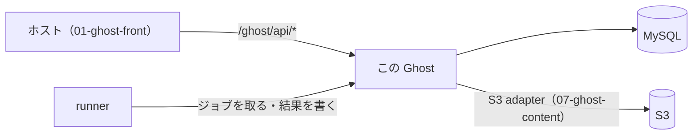

# Ghost 5.116.2 の fork（aidabo/Ghost）

このシステムの **backend**。Ghost 5.116.2 に、人物・不動産・AI ジョブなどの独自テーブルと API を足した fork。
3 つのサービス（familynews・thinkestate・mars-times）が同じこのコードを使う。フロント（`01-ghost-front`）と runner は、ここの Admin / Content API を使う。

## この文書の内容

| 節 | 内容 |
|---|---|
| [役割と位置](#役割と位置) | システムの中でどこにあるか |
| [fork で足したもの](#fork-で足したもの) | 独自のテーブル・API・その場所 |
| [中の構成](#中の構成) | 主なフォルダ |
| [取得と初回セットアップ](#取得と初回セットアップ) | repository、Node.js、依存、buildの準備 |
| [開発の手順](#開発の手順) | 入れる・起動する・テスト |
| [スキーマを変えるとき](#スキーマを変えるとき) | schema・model・migration の決まり |
| [配布](#配布) | 本番イメージの作り方と配り方 |
| [ほかのリポジトリとのつながり](#ほかのリポジトリとのつながり) | 07-ghost-content・03-koenig・04-Ghost-SDK |
| [注意](#注意) | 壊しやすい所 |
| [詳しい文書](#詳しい文書) | 01-ghost-front の docs と、このリポジトリの docs |
| [ライセンス](#ライセンス) | 上流の著作権表示 |

## 取得と初回セットアップ

複数repositoryを含む全体の取得から起動までは、Frontendの[ローカル全体環境ガイド](https://github.com/aidabo/jibunsee-react/blob/main/docs/development/00-local-full-stack.md)を参照してください。このREADMEではGhost backend固有のinstall・build・migrationを説明します。

backendは`aidabo/Ghost`のforkです。作業フォルダはfrontendと同じworkspace直下の
`00-Ghost-5.116.2`を使います。

```bash
mkdir -p ~/work/legacy
cd ~/work/legacy
git clone git@github.com:aidabo/Ghost.git 00-Ghost-5.116.2
cd 00-Ghost-5.116.2
git fetch origin main
git switch main
git pull --ff-only origin main
```

既にclone済みの場合は、作業中の変更を確認してから`main`を更新します。
未コミット変更を残したままpullやbranch切替を行わないでください。

### Node.js・Yarn

現在の開発基準はNode.js `20.19.0`です。Yarnの版はこのrepositoryのlockfileと
Ghostの開発手順に合わせます。

```bash
nvm install 20.19.0
nvm use 20.19.0
node --version                 # v20.19.0
yarn --version                 # Yarn Classic 1.22.x
```

Yarnは`yarn.lock`がYarn Classic v1形式のため、Yarn 1.xを使います。frontendと同じ
workspaceで作業する場合は`1.22.22`を使用してください。依存installとsubmodule初期化は、
後述の[開発の手順](#開発の手順)で一度だけ行います。

### 主要ツールの版

| ツール | 版 | 根拠・注意 |
|---|---|---|
| NVM | 固定なし | Node.jsの切替に使う。NVM自体の版は各開発環境で確認する |
| Node.js | `20.19.0`を開発基準にする | package.jsonはNode 18.12.1系・20.11.1系・22.13.1系を許可 |
| Ghost | `5.116.2` | `ghost/core/package.json` |
| fork deploy version | `5.116.2-next-r261022` | root `package.json`の`version` / `deployVersion`。配布時は更新値を確認 |
| Yarn | 固定なし | lockfileと既存開発環境に合わせる。frontendはYarn `1.22.22` |
| Nx | `19.8.14` | root `package.json`で明示されたbuild/test用task runner |
| Knex | `2.4.2` | `ghost/core/package.json` |
| MySQL | 固定なし | `02-ghost-compose`のcomposeと環境に従う。DB serverの実版を`SELECT VERSION()`で確認 |
| Redis | `7-alpine` | `02-ghost-compose/docker-compose.yml`のlocal image |
| Docker Engine | 固定なし | `docker --version`で確認。image tagはcompose/Dockerfileを正本にする |
| AWS CLI | v2、patch固定なし | 配布時に`aws --version`とAWS profileを確認 |

版の確認コマンド:

```bash
node --version
yarn --version
docker --version
aws --version
git submodule status
node -p "require('./package.json').devDependencies.nx"
node -p "require('./package.json').deployVersion"
node -p "require('./ghost/core/package.json').version"
```

backendの`package.json`に明示されたNode.js対応範囲と、引継ぎ基準のNode.js版が
異なる場合は、引継ぎ基準（現在は`20.19.0`）を優先し、変更時はREADMEとfrontendの
開発資料を同時に更新します。

S3 adapterを使うlocal構成では、`ghost/core/content/adapters`が
`07-ghost-content`を指すsymlinkであることも確認します。必要な共通repositoryの配置は
frontendの[workspace手順](https://github.com/aidabo/jibunsee-react/blob/main/docs/development/01-workspace.md)を参照してください。

```bash
cd ~/work/legacy/00-Ghost-5.116.2
ls -ld ghost/core/content/adapters
readlink ghost/core/content/adapters
readlink -f ghost/core/content/adapters
```

期待する相対symlink先は`../../../../07-ghost-content/adapters`です。`readlink -f`では`~/work/legacy/07-ghost-content/adapters`に解決します。link先が無い場合は
`07-ghost-content`をworkspace直下へ取得し、既存のlinkを通常ディレクトリへ置き換えません。
tracked linkを誤って変更した場合は、このrepositoryのmainから
`git restore --source=main -- ghost/core/content/adapters`で復元します。localに`main`が無い場合は
`--source=origin/main`を使います。手で`ln -s`を作らず、tracked symlinkを使います。

### local開発環境の読み込みと秘密情報

`env-dev.sh`の作成からMySQL/Redis、Ghost、Estate frontendの起動順は[全体環境ガイド](https://github.com/aidabo/jibunsee-react/blob/main/docs/development/00-local-full-stack.md)を参照してください。

ローカルの`yarn dev`は`ghost/core/core/shared/config/env/config.development.json`を読みます。本番はこのファイルを使わず、Composeがホストの`/data/ghost/config/${GHOST_CONFIG_JSON}`をコンテナの`/var/lib/ghost/config.production.json`へbind mountします。

`yarn dev`で使うlocalのDB・S3・メールなどの環境変数は、git管理外の
`02-ghost-compose/env-dev.sh`から読み込みます。開発shellごとに手動sourceする代わりに、
`~/.bashrc`へ次を追加できます。

```bash
# Export ghost development environments
[ -f ~/work/legacy/02-ghost-compose/env-dev.sh ] && source ~/work/legacy/02-ghost-compose/env-dev.sh
```

パスは開発機の配置例です。追加後は新しいshellを開くか、現在のshellで`source ~/.bashrc`を実行します。
`env-dev.sh`にはsecret関連情報が含まれるため、次を守ります。

- `env-dev.sh`の実値をREADME・PR・チャット・screenshotへ転載しない
- `env-dev.sh`をgitへ追加しない。`git -C ~/work/legacy/02-ghost-compose check-ignore -v env-dev.sh`でignore規則を確認する
- `git -C ~/work/legacy/02-ghost-compose ls-files --error-unmatch env-dev.sh`が失敗することを確認し、追跡されていないことも確認する
- `chmod 600 ~/work/legacy/02-ghost-compose/env-dev.sh`にする
- `config.development.json`や`config.local.json`へDB password、S3 access key、secret key、メールpasswordなどを直接書かない
- Ghostが読む`storage__s3__*`等のsecretは、`env-dev.sh`からexportして渡す
- `GHOST_S3_PATH_PREFIX`はlocal開発用のprefixを使い、本番prefixを使わない

`env-dev.sh.example`は`02-ghost-compose/env-dev.sh.example`にある値のないひな形です。
初回は次のようにlocalファイルを作り、実値は引継ぎ元の安全なsecret管理場所から受け取ります。

```bash
cd ~/work/legacy/02-ghost-compose
cp -n env-dev.sh.example env-dev.sh
chmod 600 env-dev.sh
```

既に`env-dev.sh`がある場合は上書きしません。既存ファイルの内容を確認・更新するときは、
secret管理場所の値と照合してから手動で変更します。

S3設定のキー名は、値を入れずに次のような`storage__s3__*`形式を使います。

```text
storage__s3__bucket
storage__s3__region
storage__s3__assetHost
storage__s3__pathPrefix
storage__s3__accessKeyId
storage__s3__secretAccessKey
```

`bucket`、`region`、`pathPrefix`、`accessKeyId`、`secretAccessKey`はS3保存に必要です。
`assetHost`はCloudFront等のCDN URLを使う場合に設定します。`env-dev.sh`の
`GHOST_S3_PATH_PREFIX`が`storage__s3__pathPrefix`へ変換されるため、local用prefixと本番prefixを混ぜません。
`source`した同じshellで、値を表示せずexport済みの変数名だけ確認するには
`compgen -e | grep '^storage__s3__'`を使います。

実値はREADMEやexampleへ貼り付けません。引継ぎ元から受け取った
`config.development.json`などにsecretが含まれていた場合は、そのままcommitせず、
secretを削除して`env-dev.sh`から環境変数として渡します。S3の環境変数名変換と起動確認は、frontendの
[backend引継ぎ資料](https://github.com/aidabo/jibunsee-react/blob/main/docs/development/03-backend-ghost.md)
を正本にします。

### 詳細なbuildとlocal起動

依存のinstall、MySQL/Redis・`ghost_db`・開発config・envの準備、build、migration初期化、
local起動の正しい順序は、重複を避けるため下の「[開発の手順](#開発の手順)」を正本とします。
Ghostは起動後に`http://localhost:2368`、管理画面は`http://localhost:2368/ghost/`で確認できます。

buildや起動で問題が出た場合は、先に次を確認します。

```bash
git status -sb
test -f ghost/core/package.json
test -e ghost/core/content/adapters
yarn build
```

## 役割と位置



- データの正はこの Ghost にある。フロントは自分の DB を持たないので、保存するものはここのテーブルに足す。
- 全体の説明は [00-overview.md](https://github.com/aidabo/jibunsee-react/blob/main/docs/development/00-overview.md)。

## fork で足したもの

| 系統 | テーブル（例） | API（`ghost/core/core/server/api/endpoints/`） |
|---|---|---|
| ソーシャル（グループ・コメント・ギャラリー・ページ部品など） | `social_groups`・`social_post_comments`・`social_components`・`social_media_assets` | `social-*.js` |
| AI（チャット・リマインダー・端末・プロジェクトなど） | `social_ai_conversations`・`social_ai_reminders`・`social_ai_projects` | `social-ai-*.js` |
| AI ジョブ（runner が処理する） | `social_ai_media_jobs`・`social_ai_chart_jobs`・`social_ai_news_jobs`・`social_ai_dzi_jobs`・`social_ai_content_bundle_jobs` | `social-ai-*-jobs.js` |
| 人物・家系図 | `persons`・`person_relations`・`person_stories`・`person_media` | `person-*.js` |
| 不動産（Estate） | `estate_properties`・`estate_inquiries`・`estate_settings`・`estate_dictionary_terms` | `estate-*.js` |
| 公開コンテンツ・販売 | `publish_posts`・`content_products`・`member_entitlements` | `publish-content*.js`・`content-products*.js` |
| 検索・記事のメディア | `post_search_index`・`post_media` | `posts-search-index*.js`・`member-post-search.js`・`post-media-*.js` |

- テーブルは `ghost/core/core/server/data/schema/schema.js`、追加のマイグレーションは
  `ghost/core/core/server/data/migrations/versions/5.116/` にある。
- API の一覧と書き方は [docs/social-api/](docs/social-api/README.md)（[API_REFERENCE.md](docs/social-api/API_REFERENCE.md)・[CUSTOM.md](docs/social-api/CUSTOM.md)）。

## 中の構成

| 場所 | 中身 |
|---|---|
| `ghost/core/core/server/api/endpoints/` | API の本体（上流 + 独自） |
| `ghost/core/core/server/web/api/endpoints/{admin,content}/` | ルートの定義 |
| `ghost/core/core/server/models/` | モデル（上流 + 独自） |
| `ghost/core/core/server/data/schema/schema.js` | テーブルの定義 |
| `ghost/core/core/server/data/migrations/` | マイグレーション（独自は `versions/5.116/`）と `hooks/init/after.js` |
| `ghost/core/content/adapters` | `07-ghost-content/adapters` への symlink（S3 の storage adapter） |
| `ghost/core/.yalc/@tryghost/` | ビルド済みの `kg-default-nodes`・`kg-html-to-lexical`・`kg-lexical-html-renderer`・`admin-api-schema`・`user-events` |
| `.docker/prd.Dockerfile` | 本番イメージの Dockerfile |
| `deploy.sh`・`deploy-on-ec2.sh` | 本番イメージの upload と、EC2 での入れ替え |
| `docs/` | fork の文書（[docs/README.md](docs/README.md)） |

## 開発の手順

手順の正は [03-backend-ghost.md](https://github.com/aidabo/jibunsee-react/blob/main/docs/development/03-backend-ghost.md)。ここでは流れだけを書く。

1. MySQL と Redis を `02-ghost-compose` の `docker-compose.yml` で起動し、DB `ghost_db` を一度だけ手で作る。
2. 設定とenvを準備する:
   - 開発の設定 `ghost/core/core/shared/config/env/config.development.json` は **git に入っていない**（`.gitignore`）。
     引き継ぎ元から受け取る。
   - S3 は `storage__s3__*`（`__` 区切り）のenvで渡す。画像のプレフィックスは開発用にする（本番のプレフィックスにしない）。
3. 依存・build・migration・起動を同じshellで実行する。`source`した環境変数を後続の全コマンドへ引き継ぐため、途中で別shellを開かない:

   ```bash
   cd ~/work/legacy/00-Ghost-5.116.2   # clone したこのリポジトリのルート（この場所は開発機の例）
   nvm use 20.19.0
   yarn
   git submodule update --init   # テーマ（Casper / Source）
   source ../02-ghost-compose/env-dev.sh
   yarn build
   yarn knex-migrator init       # 空の ghost_db にテーブルを作る
   yarn dev                      # http://localhost:2368 、管理画面は /ghost/
   ```

   Ghost本体だけを起動するときは、同じ準備をしたshellで`yarn dev:ghost`を使います。

4. テスト:

   ```bash
   yarn test:unit                     # ルート（nx）。全パッケージ
   cd ghost/core
   yarn test:unit
   yarn test:single <テストのファイル>
   yarn test:e2e
   ```

   fork で足した部分だけを流すコマンドは無い。S3 adapter の単体テストは
   `ghost/core/test/unit/server/adapters/storage/s3.test.js`（symlink 先の `07-ghost-content` を読む）。

> リポジトリ直下の `compose.yml` と、`yarn setup`・`yarn docker*` が Docker で MySQL を作る経路は **上流 Ghost のもの** で、
> このシステムでは使っていない（root/root・DB `ghost` を前提にしていて、上の設定と合わない）。

## スキーマを変えるとき

必ず次をそろえる（理由と手順は 03 の「4. スキーマを変えるとき」と [CUSTOM.md](docs/social-api/CUSTOM.md)）:

1. `ghost/core/core/server/data/schema/schema.js`
2. モデル `ghost/core/core/server/models/*.js`。新しいカラムは `permittedAttributes` にも足す（無いと黙って捨てられる）
3. マイグレーションを `versions/5.116/` に **新しく** 足す。**適用済みのマイグレーションは書き換えない**
4. FULLTEXT や名前付きのインデックスは `migrations/hooks/init/after.js` にも足す（`knex-migrator init` で作る新しい DB には、マイグレーションが走らないため）

```bash
yarn knex-migrator migrate   # 手元の DB に当てる。そのあと Ghost を再起動
```

- 手元の `ghost_db` は **複数のブランチ・worktree で共有** している。スキーマの変更はほかの作業にも効く。

## 配布

- テナント別のコマンド（`--tenant` を固定したもの）:
  - 60-think: `yarn deploy:60think` / `:build:up` / `:go` / `:verify`
  - thinkestate: `yarn deploy:estate` / `:build:up` / `:go` / `:verify`
  - 既定（tenant 省略）は 60-think。両方なら `--tenant all`。
- テナントごとの profile / account は **`deploy-targets.json` の各テナント**に
  `profile` / `account` として足す（未設定なら `deploy.env` の全体値）。

  ```json
  "60-think": { "profile": "<aws-profile>", "account": "<12桁>" }
  ```

  `profile` / `account` は上書きしたいときだけ書く（省略すれば `deploy.env` の全体値）。

  - `deploy-targets.json` は gitignore。初回は `cp deploy-targets.example.json deploy-targets.json`
  - 配布先は `instanceId` か `tags`（例 `{"System":"60-think","Role":"backend"}`）。
    `instanceId` が無ければ **running のインスタンスをタグで探す**（1 台に絞れなければ中止）。
    ASG は使っていないので、インスタンスの入れ替え時も `tags` のままでよい
  - `workdir` / `ssmParam` は必須
  - **S3 への upload は全体の `DEPLOY_AWS_PROFILE`、`DEPLOY_AWS_ACCOUNT` が必須**
  - SSM の更新と account guard はテナントごとの値
- 本番に触れず設定を確かめるとき: `yarn deploy:estate --dry-run`（tenant ごとの
  profile / account が出る）
- `yarn deploy`（all: build → upload → 配布 → verify）: `.docker/prd.Dockerfile` でイメージ
  `ghost:<deployVersion>` を作り、`s3://60-legacy/deploy-image/ghost-<version>.tar.gz` に上げ、
  既定テナント（60-think）へ配って確認する。バージョンは `package.json` の `deployVersion`。
  frontend repo の `yarn deploy` と同じ並び（`--stage all`）。
  - `yarn deploy:build:up` … build + S3 upload だけ（`deploy.sh`。SSM の version も更新）
  - `yarn deploy:go` … 配布だけ（S3 の tar を EC2 で `docker load`）
  - `yarn deploy:verify` … 確認だけ（read-only）
  - thinkestate は `--tenant thinkestate` を足す（例 `yarn deploy:go --tenant thinkestate`）。
    既定は 60-think だけ。両方なら `--tenant all`。
  - **以前の `yarn deploy`（= `bash deploy.sh`、build + upload だけ）は、今の
    `yarn deploy:build:up`。** 配布まで進むので、実行前に `yarn deploy --dry-run` で
    何が起きるかを確認できる。配布は `[y/N]` で一度止まる（非対話は `--yes` が必要）。
  - 実行例:
    ```bash
    yarn deploy --dry-run                    # 計画だけ（AWS を呼ばない）
    yarn deploy:build:up                     # build + upload（配布しない）
    yarn deploy:go --tenant all              # 両テナントへ配布
    yarn deploy:go --version <tag>           # tag を明示して配布（rollback など）
    yarn deploy --tenant thinkestate --yes   # 非対話で all
    ```
  - 先に本番用の Admin のビルド（`yarn build`）が要る。`yarn dev` のあとの Admin のままだと `deploy.sh` が止まる
    （[docs/operations-docker-admin-build.md](docs/operations-docker-admin-build.md)）。
- 本番のホストでは `deploy-on-ec2.sh <VERSION>` が、その tar を `docker load` して compose を起動し直す。
- テナントごとの環境変数・確認手順は
  [tenant/ghost-backend-deploy.md](https://github.com/aidabo/jibunsee-react/blob/main/docs/tenant/ghost-backend-deploy.md) にある。
- mars-times（janabiz）の backend は、フロント側の `yarn deploy:news:backend`（`01-ghost-front`）で配る。
- 全体の順番（backend → frontend → worker）は [08-deploy.md](https://github.com/aidabo/jibunsee-react/blob/main/docs/development/08-deploy.md)。

## ほかのリポジトリとのつながり

| リポジトリ | つながり |
|---|---|
| `07-ghost-content` | `ghost/core/content/adapters` の symlink 先。無いと S3 の storage adapter が無く、起動やテストが失敗する |
| `03-koenig`（エディタ） | ビルド済みの `kg-*` が `ghost/core/.yalc/` にコミット済み。エディタを変えるときだけ clone して yalc で入れ直す |
| `04-Ghost-SDK` | ビルド済みの `admin-api-schema` が `ghost/core/.yalc/` にある。API のスキーマを変えるときだけ clone する |
| `02-ghost-compose` | 開発用の MySQL / Redis と、本番サーバの compose |
| `01-ghost-front` | この API を使うフロントと runner。引き継ぎの文書もここ |

## 注意

- 本番イメージは上流の `ghost:5.116.2-alpine` に、`.docker/prd.Dockerfile` の `COPY` に書いたファイルだけを重ねて作る。
  **`COPY` に無い場所に足したファイルは本番に入らない。** 新しいフォルダやサービスを足したら Dockerfile も直す。
- 本番の S3 adapter はイメージではなく、ホストの content ボリューム（`/var/lib/ghost/content` に mount）から読まれる。
- `config.development.json` などの設定ファイルと `.env*` の中身をコミットしない。

## 詳しい文書

- [docs/development/README.md](https://github.com/aidabo/jibunsee-react/blob/main/docs/development/README.md) — 引き継ぎの入口
- [03-backend-ghost.md](https://github.com/aidabo/jibunsee-react/blob/main/docs/development/03-backend-ghost.md) — この Ghost をローカルで動かす
- [08-deploy.md](https://github.com/aidabo/jibunsee-react/blob/main/docs/development/08-deploy.md) — 配布
- [tenant/ghost-db-init-and-index-notes.md](https://github.com/aidabo/jibunsee-react/blob/main/docs/tenant/ghost-db-init-and-index-notes.md) — DB の初期化とインデックス
- このリポジトリの [docs/README.md](docs/README.md)・[docs/social-api/README.md](docs/social-api/README.md)・[AGENT.md](AGENT.md)

## ライセンス

上流の Ghost は MIT ライセンス（[LICENSE](LICENSE)）。Copyright (c) 2013-2025 Ghost Foundation。
Ghost と Ghost のロゴは Ghost Foundation Ltd の商標（[trademark policy](https://ghost.org/trademark/)）。
