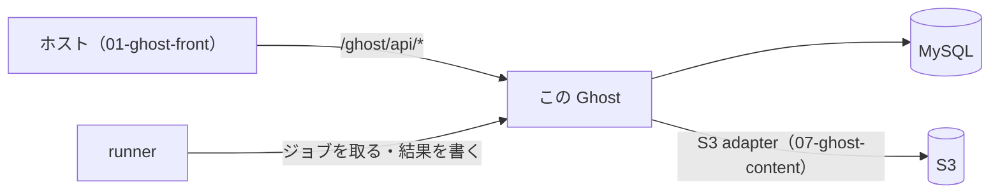

# Ghost 5.116.2 の fork（aidabo/Ghost）

このシステムの **backend**。Ghost 5.116.2 に、人物・不動産・AI ジョブなどの独自テーブルと API を足した fork。
3 つのサービス（familynews・thinkestate・mars-times）が同じこのコードを使う。フロント（`01-ghost-front`）と runner は、ここの Admin / Content API を使う。

## この文書の内容

| 節 | 内容 |
|---|---|
| [役割と位置](#役割と位置) | システムの中でどこにあるか |
| [fork で足したもの](#fork-で足したもの) | 独自のテーブル・API・その場所 |
| [中の構成](#中の構成) | 主なフォルダ |
| [開発の手順](#開発の手順) | 入れる・起動する・テスト |
| [スキーマを変えるとき](#スキーマを変えるとき) | schema・model・migration の決まり |
| [配布](#配布) | 本番イメージの作り方と配り方 |
| [ほかのリポジトリとのつながり](#ほかのリポジトリとのつながり) | 07-ghost-content・03-koenig・04-Ghost-SDK |
| [注意](#注意) | 壊しやすい所 |
| [詳しい文書](#詳しい文書) | 01-ghost-front の docs と、このリポジトリの docs |
| [ライセンス](#ライセンス) | 上流の著作権表示 |

## 役割と位置



- データの正はこの Ghost にある。フロントは自分の DB を持たないので、保存するものはここのテーブルに足す。
- 全体の説明は [00-overview.md](https://github.com/aidabo/jibunsee-react/blob/main/docs/development/00-overview.md)。

## fork で足したもの

| 系統 | テーブル（例） | API（`ghost/core/core/server/api/endpoints/`） |
|---|---|---|
| ソーシャル（グループ・コメント・ギャラリー・ページ部品など） | `social_groups`・`social_post_comments`・`social_components`・`social_media_assets` | `social-*.js` |
| AI（チャット・リマインダー・端末・プロジェクトなど） | `social_ai_conversations`・`social_ai_reminders`・`social_ai_projects` | `social-ai-*.js` |
| AI ジョブ（runner が処理する） | `social_ai_media_jobs`・`social_ai_chart_jobs`・`social_ai_news_jobs`・`social_ai_dzi_jobs`・`social_ai_content_bundle_jobs` | `social-ai-*-jobs.js` |
| 人物・家系図 | `persons`・`person_relations`・`person_stories`・`person_media` | `person-*.js` |
| 不動産（Estate） | `estate_properties`・`estate_inquiries`・`estate_settings`・`estate_dictionary_terms` | `estate-*.js` |
| 公開コンテンツ・販売 | `publish_posts`・`content_products`・`member_entitlements` | `publish-content*.js`・`content-products*.js` |
| 検索・記事のメディア | `post_search_index`・`post_media` | `posts-search-index*.js`・`member-post-search.js`・`post-media-*.js` |

- テーブルは `ghost/core/core/server/data/schema/schema.js`、追加のマイグレーションは
  `ghost/core/core/server/data/migrations/versions/5.116/` にある。
- API の一覧と書き方は [docs/social-api/](docs/social-api/README.md)（[API_REFERENCE.md](docs/social-api/API_REFERENCE.md)・[CUSTOM.md](docs/social-api/CUSTOM.md)）。

## 中の構成

| 場所 | 中身 |
|---|---|
| `ghost/core/core/server/api/endpoints/` | API の本体（上流 + 独自） |
| `ghost/core/core/server/web/api/endpoints/{admin,content}/` | ルートの定義 |
| `ghost/core/core/server/models/` | モデル（上流 + 独自） |
| `ghost/core/core/server/data/schema/schema.js` | テーブルの定義 |
| `ghost/core/core/server/data/migrations/` | マイグレーション（独自は `versions/5.116/`）と `hooks/init/after.js` |
| `ghost/core/content/adapters` | `07-ghost-content/adapters` への symlink（S3 の storage adapter） |
| `ghost/core/.yalc/@tryghost/` | ビルド済みの `kg-default-nodes`・`kg-html-to-lexical`・`kg-lexical-html-renderer`・`admin-api-schema`・`user-events` |
| `.docker/prd.Dockerfile` | 本番イメージの Dockerfile |
| `deploy.sh`・`deploy-on-ec2.sh` | 本番イメージの upload と、EC2 での入れ替え |
| `docs/` | fork の文書（[docs/README.md](docs/README.md)） |

## 開発の手順

手順の正は [03-backend-ghost.md](https://github.com/aidabo/jibunsee-react/blob/main/docs/development/03-backend-ghost.md)。ここでは流れだけを書く。

1. MySQL を `02-ghost-compose` の `docker-compose.yml` で起動し、DB `ghost_db` を一度だけ手で作る。
2. 依存とビルド:

   ```bash
   cd ~/work/legacy/00-Ghost-5.116.2
   nvm use 20.19.0
   yarn
   git submodule update --init   # テーマ（Casper / Source）
   yarn build
   yarn knex-migrator init       # 空の ghost_db にテーブルを作る
   ```

3. 設定と env:
   - 開発の設定 `ghost/core/core/shared/config/env/config.development.json` は **git に入っていない**（`.gitignore`）。
     引き継ぎ元から受け取る。
   - S3 は `storage__s3__*`（`__` 区切り）の env で渡す。`02-ghost-compose/env-dev.sh` を `source` してから起動する。
     画像のプレフィックスは開発用にする（本番のプレフィックスにしない）。
4. 起動: `yarn dev`（http://localhost:2368 、管理画面は `/ghost/`）。Ghost 本体だけなら `yarn dev:ghost`。
5. テスト:

   ```bash
   yarn test:unit                     # ルート（nx）。全パッケージ
   cd ghost/core
   yarn test:unit
   yarn test:single <テストのファイル>
   yarn test:e2e
   ```

   fork で足した部分だけを流すコマンドは無い。S3 adapter の単体テストは
   `ghost/core/test/unit/server/adapters/storage/s3.test.js`（symlink 先の `07-ghost-content` を読む）。

> リポジトリ直下の `compose.yml` と、`yarn setup`・`yarn docker*` が Docker で MySQL を作る経路は **上流 Ghost のもの** で、
> このシステムでは使っていない（root/root・DB `ghost` を前提にしていて、上の設定と合わない）。

## スキーマを変えるとき

必ず次をそろえる（理由と手順は 03 の「4. スキーマを変えるとき」と [CUSTOM.md](docs/social-api/CUSTOM.md)）:

1. `ghost/core/core/server/data/schema/schema.js`
2. モデル `ghost/core/core/server/models/*.js`。新しいカラムは `permittedAttributes` にも足す（無いと黙って捨てられる）
3. マイグレーションを `versions/5.116/` に **新しく** 足す。**適用済みのマイグレーションは書き換えない**
4. FULLTEXT や名前付きのインデックスは `migrations/hooks/init/after.js` にも足す（`knex-migrator init` で作る新しい DB には、マイグレーションが走らないため）

```bash
yarn knex-migrator migrate   # 手元の DB に当てる。そのあと Ghost を再起動
```

- 手元の `ghost_db` は **複数のブランチ・worktree で共有** している。スキーマの変更はほかの作業にも効く。

## 配布

- `yarn deploy`（= `deploy.sh`）: `.docker/prd.Dockerfile` でイメージ `ghost:<deployVersion>` を作り、
  `s3://60-legacy/deploy-image/ghost-<version>.tar.gz` に上げる。バージョンは `package.json` の `deployVersion`。
  - 先に本番用の Admin のビルド（`yarn build`）が要る。`yarn dev` のあとの Admin のままだと `deploy.sh` が止まる
    （[docs/operations-docker-admin-build.md](docs/operations-docker-admin-build.md)）。
- 本番のホストでは `deploy-on-ec2.sh <VERSION>` が、その tar を `docker load` して compose を起動し直す。
- テナントへ配る `yarn deploy:backend --tenant <60-think|thinkestate>` は
  [tenant/ghost-backend-deploy.md](https://github.com/aidabo/jibunsee-react/blob/main/docs/tenant/ghost-backend-deploy.md) にある。
  **このコマンドはまだ main に入っていない**（ブランチ `private/feat/deploy-backend-command`）。
- mars-times（janabiz）の backend は、フロント側の `yarn deploy:news:backend`（`01-ghost-front`）で配る。
- 全体の順番（backend → frontend → worker）は [08-deploy.md](https://github.com/aidabo/jibunsee-react/blob/main/docs/development/08-deploy.md)。

## ほかのリポジトリとのつながり

| リポジトリ | つながり |
|---|---|
| `07-ghost-content` | `ghost/core/content/adapters` の symlink 先。無いと S3 の storage adapter が無く、起動やテストが失敗する |
| `03-koenig`（エディタ） | ビルド済みの `kg-*` が `ghost/core/.yalc/` にコミット済み。エディタを変えるときだけ clone して yalc で入れ直す |
| `04-Ghost-SDK` | ビルド済みの `admin-api-schema` が `ghost/core/.yalc/` にある。API のスキーマを変えるときだけ clone する |
| `02-ghost-compose` | 開発用の MySQL / Redis と、本番サーバの compose |
| `01-ghost-front` | この API を使うフロントと runner。引き継ぎの文書もここ |

## 注意

- 本番イメージは上流の `ghost:5.116.2-alpine` に、`.docker/prd.Dockerfile` の `COPY` に書いたファイルだけを重ねて作る。
  **`COPY` に無い場所に足したファイルは本番に入らない。** 新しいフォルダやサービスを足したら Dockerfile も直す。
- 本番の S3 adapter はイメージではなく、ホストの content ボリューム（`/var/lib/ghost/content` に mount）から読まれる。
- `config.development.json` などの設定ファイルと `.env*` の中身をコミットしない。

## 詳しい文書

- [docs/development/README.md](https://github.com/aidabo/jibunsee-react/blob/main/docs/development/README.md) — 引き継ぎの入口
- [03-backend-ghost.md](https://github.com/aidabo/jibunsee-react/blob/main/docs/development/03-backend-ghost.md) — この Ghost をローカルで動かす
- [08-deploy.md](https://github.com/aidabo/jibunsee-react/blob/main/docs/development/08-deploy.md) — 配布
- [tenant/ghost-db-init-and-index-notes.md](https://github.com/aidabo/jibunsee-react/blob/main/docs/tenant/ghost-db-init-and-index-notes.md) — DB の初期化とインデックス
- このリポジトリの [docs/README.md](docs/README.md)・[docs/social-api/README.md](docs/social-api/README.md)・[AGENT.md](AGENT.md)

## ライセンス

上流の Ghost は MIT ライセンス（[LICENSE](LICENSE)）。Copyright (c) 2013-2025 Ghost Foundation。
Ghost と Ghost のロゴは Ghost Foundation Ltd の商標（[trademark policy](https://ghost.org/trademark/)）。
